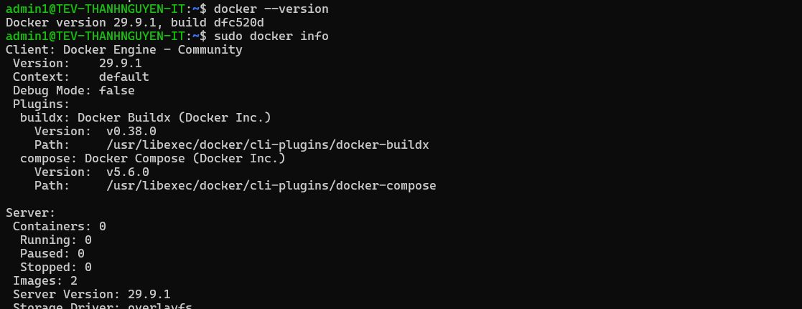
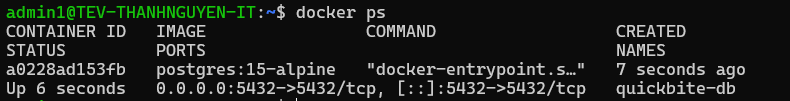
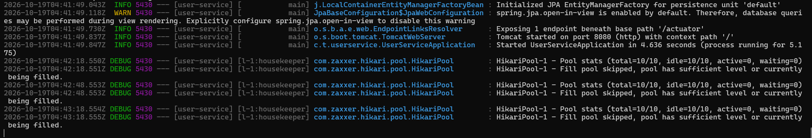

# Báo cáo thực hành tổng hợp – Session 02

Môi trường: Windows 11 + WSL2 (Ubuntu 24.04), Docker Engine cài trực tiếp trong Ubuntu.

## Nhiệm vụ 1: Cài đặt và xác thực Docker Engine

```bash
sudo apt-get update
sudo apt-get install docker.io -y
docker --version
sudo docker info
```



## Nhiệm vụ 2: Khởi chạy cơ sở dữ liệu bằng Docker

```bash
docker run -d \
  --name quickbite-db \
  -p 5432:5432 \
  -e POSTGRES_PASSWORD=secret \
  postgres:15-alpine

docker ps
```

Container `quickbite-db` ở trạng thái `Up`, ánh xạ `0.0.0.0:5432->5432/tcp`.



## Nhiệm vụ 3 & 4: Tải mã nguồn, biên dịch và chạy ứng dụng

```bash
mkdir -p ~/workspace && cd ~/workspace
git clone https://github.com/thvhdvy/NguyenHuuThanh_JB-IOC-260310_DevOps_SS01_-user-service
cd NguyenHuuThanh_JB-IOC-260310_DevOps_SS01_-user-service

chmod +x gradlew
./gradlew clean bootJar
ls build/libs
```

Cấu hình kết nối database (biến môi trường):

```
export DB_URL=jdbc:postgresql://localhost:5432/postgres
export DB_USERNAME=postgres
export DB_PASSWORD=secret
```

Chạy ứng dụng:

```bash
java -jar build/libs/user-service-0.0.1-SNAPSHOT.jar
```

Kết quả: file `.jar` được sinh ra trong `build/libs/`. Log khởi động ghi nhận `HikariPool-1 - Start completed`, Hibernate khởi tạo `EntityManagerFactory` thành công và `Started UserServiceApplication`, không có lỗi kết nối.



## Kết luận

- Docker Engine cài đặt và hoạt động bình thường.
- Container PostgreSQL `quickbite-db` chạy ở cổng 5432.
- Ứng dụng Spring Boot chạy trực tiếp trên máy host kết nối thành công tới database trong container qua cổng đã ánh xạ.
